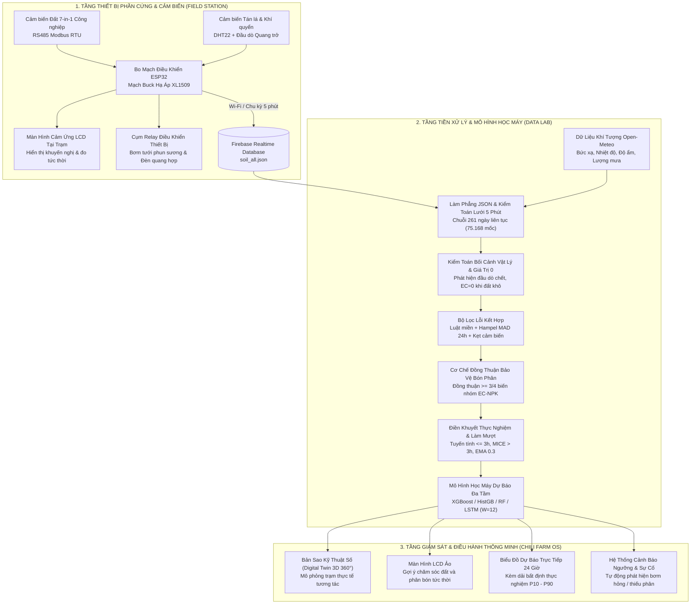

# THIẾT KẾ HỆ THỐNG PHẦN CỨNG IOT & CẤU TRÚC DỮ LIỆU DỰ ÁN
> **Dự án:** Chili Smart-Farm Data Lab — Hệ Thống Giám Sát, Tiền Xử Lý Dữ Liệu IoT & Dự Báo Đa Tầm (Vườn Ớt Thông Minh)  
> **Nhóm tác giả:** Nguyễn Đình Quốc Bảo, Nguyễn Lâm Y Khang, Trần Minh Khôi, Trương Hoàng Duy  
> **Đơn vị:** Lớp Cao học Kỹ thuật Xử lý Dữ liệu — Trường Đại học Công nghệ Thông tin, ĐHQG-HCM (UIT)  

---

## 1. TỔNG QUAN KIẾN TRÚC HỆ THỐNG ĐẦU-CUỐI (END-TO-END)

Hệ thống được nhóm thiết kế và xây dựng trọn vẹn từ tầng thiết bị vật lý tại hiện trường đến tầng xử lý dữ liệu và giao diện điều hành thông minh:



---

## 2. THIẾT KẾ PHẦN CỨNG TRẠM QUAN TRẮC THỰC ĐỊA

### 2.1. Cấu hình bo mạch điều khiển trung tâm
* **Vi điều khiển:** ESP32-WROOM-32 (Dual-core Xtensa 32-bit LX6, 240 MHz, tích hợp Wi-Fi 802.11 b/g/n và Bluetooth BLE).
* **Mạch nguồn:** Mạch hạ áp Buck DC-DC dựa trên IC XL1509, chuyển đổi nguồn đầu vào 12V DC từ adapter hoặc pin năng lượng mặt trời về 5V và 3.3V ổn định cấp cho vi điều khiển và các cảm biến.
* **Giao tiếp công nghiệp:** IC chuyển đổi UART sang RS485 (MAX485 / SP3485) hỗ trợ giao thức Modbus RTU truyền thông xa lên đến 100m, chống nhiễu công nghiệp trong môi trường đất ẩm.
* **Màn hình giao diện tại trạm:** Màn hình cảm ứng LCD màu hiển thị các chỉ số đo trực tiếp, mức pin, trạng thái Wi-Fi và đưa ra khuyến nghị xử lý tức thời cho người chăm sóc vườn.
* **Cơ cấu chấp hành:** Cụm relay 5V cách ly quang (Optocoupler) điều khiển bật/tắt máy bơm nước mini tưới gốc/phun sương và thanh đèn LED chiếu sáng bổ sung quang hợp.

### 2.2. Danh mục cảm biến thu thập
1. **Cảm biến đất 7-in-1 công nghiệp (RS485 Modbus):**
   * Tích hợp 3 chấu kim loại thép không gỉ 316 chống ăn mòn hóa học.
   * Đo đồng thời 7 chỉ số lý hóa: Độ ẩm thể tích đất (%VWC), Nhiệt độ tầng rễ (°C), Độ dẫn điện EC (mS/cm), Độ chua/kiềm (pH), Hàm lượng Đạm (N), Lân (P), Kali (K).
2. **Cảm biến nhiệt độ & độ ẩm không khí:** Cảm biến kỹ thuật số DHT22 / SHT30 đo nhiệt độ và độ ẩm tương đối của vùng vi khí hậu xung quanh tán lá ớt.
3. **Cảm biến cường độ ánh sáng:** Đầu dò quang trở / cảm biến quang tuyến đo cường độ ánh sáng khả kiến tán xạ trên luống trồng.

---

## 3. BẢNG ÁNH XẠ THUỘC TÍNH DỮ LIỆU (DATA ATTRIBUTE MAPPING)

| STT | Cảm biến phần cứng | Thanh ghi Modbus / Chân nối | Tên trường Firebase | Cột DataFrame (`soil_extended.csv`) | Đơn vị | Ngưỡng an toàn tối ưu |
| :---: | :--- | :--- | :--- | :--- | :---: | :---: |
| 1 | Cảm biến đất 7-in-1 | Thanh ghi `0x0000` | `moisture` | `moisture` | %VWC | 38 – 62 % |
| 2 | Cảm biến đất 7-in-1 | Thanh ghi `0x0001` | `soiltemp` | `soiltemp` | °C | 18 – 33 °C |
| 3 | Cảm biến đất 7-in-1 | Thanh ghi `0x0002` | `EC` | `EC` | mS/cm | 0.25 – 1.50 mS/cm |
| 4 | Cảm biến đất 7-in-1 | Thanh ghi `0x0003` | `pH` | `pH` | pH | 5.0 – 7.5 pH |
| 5 | Cảm biến đất 7-in-1 | Thanh ghi `0x0004` | `N` | `N` | mg/kg | 25 – 250 mg/kg |
| 6 | Cảm biến đất 7-in-1 | Thanh ghi `0x0005` | `P` | `P` | mg/kg | 120 – 450 mg/kg |
| 7 | Cảm biến đất 7-in-1 | Thanh ghi `0x0006` | `K` | `K` | mg/kg | 130 – 500 mg/kg |
| 8 | Cảm biến DHT22 / SHT | Chân GPIO ESP32 | `temperature` | `temperature` | °C | 20 – 36 °C |
| 9 | Cảm biến DHT22 / SHT | Chân GPIO ESP32 | `humidity` | `humidity` | %RH | 45 – 92 % |
| 10 | Đầu dò quang trở | ADC ESP32 | `light` | `light` | klux | 0 – 25 klux |
| 11 | Khí tượng Open-Meteo | Tọa độ TP.HCM | *(Ngoại sinh)* | `w_air_T` | °C | — |
| 12 | Khí tượng Open-Meteo | Tọa độ TP.HCM | *(Ngoại sinh)* | `w_air_RH` | %RH | — |
| 13 | Khí tượng Open-Meteo | Tọa độ TP.HCM | *(Ngoại sinh)* | `w_rad` | W/m² | — |
| 14 | Khí tượng Open-Meteo | Tọa độ TP.HCM | *(Ngoại sinh)* | `w_rain_5min`| mm | — |

---

## 4. QUY TRÌNH THU THẬP & ĐỒNG BỘ DỮ LIỆU ĐÁM MÂY

1. **Chu kỳ lấy mẫu tại trạm (Edge Sampling):**
   * Cứ mỗi 5 phút, vi điều khiển ESP32 gửi lệnh đọc Modbus RTU qua cổng RS485 đến cảm biến 7-in-1 và đọc cảm biến môi trường.
   * Dữ liệu được đóng gói thành định dạng JSON lồng 3 cấp theo cấu trúc:
     ```json
     {
       "data": {
         "YYYY-MM-DD": {
           "HH:MM": {
             "temperature": 28.5,
             "humidity": 75.2,
             "soiltemp": 26.1,
             "moisture": 52.4,
             "pH": 6.35,
             "EC": 0.68,
             "N": 65.2,
             "P": 210.4,
             "K": 235.1,
             "light": 14.8
           }
         }
       }
     }
     ```
2. **Đẩy dữ liệu lên Firebase Realtime Database:**
   * ESP32 kết nối Wi-Fi tại vườn và sử dụng Firebase REST API / Firebase Arduino Client để ghi nhận dữ liệu theo thời gian thực.
   * Cơ chế hàng đợi đệm (Ring Buffer) trên RAM/Flash của ESP32 giúp lưu tạm thời dữ liệu nếu mạng Wi-Fi bị gián đoạn, tự động đồng bộ bù ngay khi có mạng trở lại.
3. **Đồng bộ thời tiết ngoại sinh (Open-Meteo API):**
   * Hệ thống tự động thu thập lịch sử khí tượng hourly tại tọa độ trạm quan trắc (TP.HCM) và nội suy tuyến tính về lưới 5 phút để khớp đồng bộ từng hàng với dữ liệu cảm biến đất.
